# Mandaozi Learning Architecture Dump (Current Implementation)

**Scope:** Inspection/documentation only. No code, DB, or existing implementation modified.  
**Date:** 2026-11-27  
**Evidence base (inspected):**  
`src/db/schema/content.ts`, `src/db/schema/users.ts`, `src/db/schema/phonics.ts`, `src/db/repositories/{roadmaps,world,user-state}.repo.ts`, `src/db/migrations/0000-0003*.sql`, `src/modules/roadmaps/{types,utils,components,constants}/*`, `src/modules/world/{components,constants}/*`, `src/store/madara-store.ts`, `src/components/shared/user-state-sync.tsx`, `src/app/(app)/{roadmaps,world/**}/page.tsx`, `src/app/api/auth/[...all]/route.ts`, `src/modules/catalog/constants/catalog.ts`, `src/modules/enrollment/components/intensive-gate.tsx`, `docs/ROADMAP-SILABUS.md`, `docs/LEARNING-HIERARCHY.md`.

**Legend:** **[EXISTING]** observed in code/DB. **[PARTIAL]** exists but incomplete/inconsistent. **[MISSING]** not found. **[RECOMMENDED]** proposed improvement, not implemented.

---

## 1. Current Learning Architecture Overview

### 1.1 High-level model (existing)

Mandaozi currently has **multiple parallel learning structures**, not one unified Course/Syllabus/Section/Item model:

| Domain | Role | Main implementation |
|---|---|---|
| **World** | Category-based exploration/lessons | `world_categories`, `world_category_lessons`, `src/modules/world/*`, `/world/*` |
| **Roadmap** | Visual structured learning path (primary “course-like” path) | `roadmaps`, `roadmap_nodes`, `roadmap_edges`, `roadmap_node_prerequisites`, `src/modules/roadmaps/*`, `/roadmaps` |
| **Dao** | Simplified tracked view of active roadmap | `DaoPage` `/world/dao`, uses `selectedPathRoadmapId` + `buildDaoRoadmap` |
| **Phonics** | Separate learning subsystem | `phonics_*` tables/progress, `/practice/pinyin-zhuyin` |
| **Vocabulary/Practice** | Practice/content tools, not course hierarchy | `vocabulary_words`, practice routes, catalog |
| **Intensive Program** | Premium gated program UI (separate domain) | `IntensiveGateCard`, `intensiveEnrolled` flag; no checkout/enrollment flow in app |

### 1.2 Requested component mapping

| Requested component | Current implementation status | Evidence |
|---|---|---|
| **Course** | **[PARTIAL]** No `courses` table/entity. Closest equivalents: `RoadmapDef` (structured path) and `WorldCategory` (category). Catalog has learning items; Intensive Program is a gated product, not a course entity. | `content.ts`, `roadmap.ts`, `world.ts`, `catalog.ts`, `intensive-gate.tsx` |
| **Syllabus** | **[PARTIAL]** `RoadmapSilabusDef` exists per roadmap (`RoadmapDef.silabus?`, DB `roadmaps.silabus_json`), UI `RoadmapSilabus` under Interactive Roadmap. Current static roadmap data has no `silabus` filled; placeholder/skeleton. | `roadmap.ts`, `roadmap-silabus.tsx`, `roadmaps.repo.ts`, migration `0002`, `ROADMAP-SILABUS.md` |
| **Roadmap** | **[EXISTING]** Visual path with nodes/edges/prerequisites/milestones/categories/positions. ReactFlow canvas. | `roadmap.ts`, `roadmap-canvas.tsx`, `roadmap-progress.ts`, DB roadmap tables |
| **Section** | **[PARTIAL]** Two forms: `RoadmapSilabusSection {id,title,items[]}` inside syllabus JSON; `world_categories` + `world_category_lessons` as category-section-like grouping. No generic `sections` table. | `roadmap.ts`, `content.ts` |
| **Section Items** | **[PARTIAL]** Silabus items are plain strings. World has `world_category_lessons` rows. Roadmap nodes have `lessonInfo` (label/kind/href). No unified section-item entity. | `roadmap.ts`, `content.ts`, `world-page.tsx` |
| **Student Learning Progress** | **[EXISTING/PARTIAL]** Tracked via `user_roadmap_node_progress`, `user_lesson_completions`, `user_progress`, phonics progress tables; Zustand persisted + `/api/user-state` sync (madara/phonics). No unified per-active-path progress model; `roadmapChoiceById` local-only (Fase 1). | `users.ts`, `user-state.repo.ts`, `user-state-sync.tsx`, `madara-store.ts` |

### 1.3 Business logic alignment (important)

- **No enrollment-based learning path activation for Roadmap/World:** **[EXISTING]** User can select active roadmap via `setSelectedPathRoadmapId` / `RoadmapPathSelectButton` without approval. `DaoPage` reads selected path; empty state prompts to pick roadmap.
- **Free exploration:** **[EXISTING]** Roadmaps/World routes are browseable; roadmap selector and World categories are accessible.
- **Switch active path without approval:** **[EXISTING]** `setSelectedPathRoadmapId` replaces active id; “Ganti path”.
- **Independent progress per user/path:** **[PARTIAL]** Roadmap node progress is keyed by `(userId, roadmapId, nodeId)`. But `user_progress` (xp/streak/lessonsCompleted/accuracy) is global per user, not per learning path; `user_lesson_completions` is global by `lessonKey`. Varian Node choice is local-only currently.
- **Enrollment-like signal exists for Intensive Program:** **[EXISTING, separate domain]** `intensiveEnrolled` in `user_profiles`/store; `IntensiveGateCard` UI says “No Active Enrollment / Enroll / Contact Support”. This is a premium program gate, not roadmap/course enrollment flow.

---

## 2. Existing Database / Entity Structure

### 2.1 Content / learning entities (`src/db/schema/content.ts`)

| Table | Purpose | Key fields | Notes |
|---|---|---|---|
| `vocabulary_words` | Dictionary/vocab content | `id, hanzi, pinyin, meaning_en, meaning_id, hsk_level, example_hanzi, example_meaning_id, audio_url, sort_order` | Unique `hanzi`; not tied to course/section hierarchy. |
| `world_categories` | World category (category-like) | `id, name, hanzi, subtitle_pinyin, description, xp, sort_order` | Static-seed-like content. |
| `world_category_lessons` | World lesson/item rows | `id, category_id FK, title, kind, sort_order` | Cascade on category delete. Simple section-item equivalent. |
| `world_tone_options` | Tone quiz options | `id, label, sort_order` | Content/support data. |
| `roadmaps` | Roadmap/course-path container | `id, title, description, sort_order, silabus_json, world_category_id` | `silabus_json` added migration 0002; `world_category_id` added 0002. |
| `roadmap_nodes` | Roadmap node | `id, roadmap_id FK, title, description, category, estimated_duration, lesson_kind, lesson_label, lesson_href, pos_x, pos_y, sort_order` | No `choices_json` column (Varian Node choices are static in TS data currently). |
| `roadmap_node_prerequisites` | Node prerequisite | `node_id FK, prerequisite_node_id FK`, unique pair | Represents prerequisite graph. |
| `roadmap_edges` | Visual graph edge | `id, roadmap_id FK, source_node_id FK, target_node_id FK, kind` | `kind` main/branch; no `choice_id`. |

### 2.2 User / progress entities (`src/db/schema/users.ts`)

| Table | Purpose | Key fields | Notes |
|---|---|---|---|
| `users`, `sessions`, `accounts`, `verifications` | Auth (Better Auth) | standard auth fields | Auth only. |
| `user_profiles` | User settings/profile | `user_id PK/FK, goal, level, daily_goal_min, language, theme_mode, reminders, sound, onboarding_done, intensive_enrolled, sidebar_collapsed, more_menu_layout, selected_path_roadmap_id, updated_at` | `selected_path_roadmap_id` added migration 0003; no FK declared in schema. |
| `user_progress` | Global aggregate progress | `user_id PK/FK, xp, words_mastered, lessons_completed, streak_days, accuracy, claimed_daily_reward, updated_at` | Global, not per roadmap/path. |
| `user_favorites` | Favorite vocab | `user_id, hanzi, vocabulary_id?, created_at`, PK(user,hanzi) | — |
| `user_task_completions` | Task completion | `user_id, task_id, xp_awarded, completed_at` | Global task IDs. |
| `user_lesson_completions` | Lesson completion | `user_id, lesson_key, xp_awarded, completed_at` | Global by lesson key; no roadmap/course FK. |
| `user_roadmap_node_progress` | Roadmap node progress | `user_id, roadmap_id, node_id, status, updated_at`, PK(user,roadmap,node) | `status`: “completed”/“in-progress”. Independent per user+roadmap+node. |
| `user_phonics_settings`, `phonics_lesson_progress`, `phonics_symbol_progress`, `phonics_incorrect_answers` | Phonics subsystem progress | per phonics schema | Separate domain. |

### 2.3 Missing / not present (for requested model)

- **[MISSING]** `courses`, `course_enrollments` (intentionally not wanted by business rule for learning paths).
- **[MISSING]** normalized `syllabus`/`sections`/`section_items` tables (syllabus is JSON in `roadmaps.silabus_json`; sections/items inside JSON).
- **[MISSING]** `user_roadmap_node_choices` / `roadmap_nodes.choices_json` (Fase 1 choice is local store only).
- **[MISSING]** explicit `user_active_learning_path` history/audit (only current `selected_path_roadmap_id`).
- **[MISSING]** FK/constraint from `user_profiles.selected_path_roadmap_id` to `roadmaps.id`.
- **[MISSING]** assessment attempt/submission/score entities for roadmap assessments.

---

## 3. Entity Relationship Diagram (Mermaid ERD)

```mermaid
erDiagram
    USERS ||--o| USER_PROFILES : has
    USERS ||--o| USER_PROGRESS : has
    USERS ||--o{ USER_FAVORITES : has
    USERS ||--o{ USER_TASK_COMPLETIONS : completes
    USERS ||--o{ USER_LESSON_COMPLETIONS : completes
    USERS ||--o{ USER_ROADMAP_NODE_PROGRESS : tracks
    USERS ||--o{ PHONICS_LESSON_PROGRESS : tracks
    USERS ||--o{ PHONICS_SYMBOL_PROGRESS : tracks
    USERS ||--o{ PHONICS_INCORRECT_ANSWERS : records

    ROADMAPS ||--o{ ROADMAP_NODES : contains
    ROADMAPS ||--o{ ROADMAP_EDGES : contains
    ROADMAP_NODES ||--o{ ROADMAP_NODE_PREREQUISITES : requires
    ROADMAP_NODES ||--o{ ROADMAP_NODE_PREREQUISITES : "is prerequisite"
    ROADMAP_NODES ||--o{ USER_ROADMAP_NODE_PROGRESS : "progressed by"
    ROADMAPS ||--o{ USER_ROADMAP_NODE_PROGRESS : "scoped by"
    ROADMAPS ||--o| USER_PROFILES : "selected active path (logical)"

    WORLD_CATEGORIES ||--o{ WORLD_CATEGORY_LESSONS : contains
    ROADMAPS }o..o| WORLD_CATEGORIES : "worldCategoryId (logical, optional)"

    VOCABULARY_WORDS ||--o{ USER_FAVORITES : "optional ref"

    USERS {
      text id PK
      text email UK
    }
    USER_PROFILES {
      text user_id PK,FK
      text goal
      text level
      int daily_goal_min
      bool onboarding_done
      bool intensive_enrolled
      text selected_path_roadmap_id "nullable, logical ref"
      int updated_at
    }
    USER_PROGRESS {
      text user_id PK,FK
      int xp
      int words_mastered
      int lessons_completed
      int streak_days
      int accuracy
      bool claimed_daily_reward
    }
    ROADMAPS {
      text id PK
      text title
      text description
      int sort_order
      text silabus_json "RoadmapSilabusDef JSON"
      text world_category_id "nullable logical ref"
    }
    ROADMAP_NODES {
      text id PK
      text roadmap_id FK
      text title
      text description
      text category
      text estimated_duration
      text lesson_kind
      text lesson_label
      text lesson_href
      real pos_x
      real pos_y
      int sort_order
    }
    ROADMAP_NODE_PREREQUISITES {
      text node_id FK
      text prerequisite_node_id FK
      "UK(node_id, prerequisite_node_id)"
    }
    ROADMAP_EDGES {
      text id PK
      text roadmap_id FK
      text source_node_id FK
      text target_node_id FK
      text kind "main|branch"
    }
    USER_ROADMAP_NODE_PROGRESS {
      text user_id PK,FK
      text roadmap_id PK,FK
      text node_id PK,FK
      text status "completed|in-progress"
      int updated_at
    }
    USER_LESSON_COMPLETIONS {
      text user_id PK,FK
      text lesson_key PK
      int xp_awarded
      int completed_at
    }
    WORLD_CATEGORIES {
      text id PK
      text name
      text hanzi
      text subtitle_pinyin
      text description
      int xp
      int sort_order
    }
    WORLD_CATEGORY_LESSONS {
      text id PK
      text category_id FK
      text title
      text kind
      int sort_order
    }
```



**ERD notes:** Dashed/logical refs are not DB-enforced FKs in schema: `user_profiles.selected_path_roadmap_id -> roadmaps.id`, `roadmaps.world_category_id -> world_categories.id`. `RoadmapSilabusDef.sections/items` and node `choices` (Fase 1) are not normalized tables.

---

## 4. Learning Content Hierarchy

### 4.1 Existing hierarchy (as implemented)

```text
World
└── WorldCategory (world_categories / WORLD_CATEGORIES)
    └── Lesson/Item label (world_category_lessons / lessons[])
        └── (actual lesson experience partly route-based; no unified item entity)

Roadmap (learning path / "course-like")
└── RoadmapDef
    ├── Silabus (optional JSON) - RoadmapSilabusDef
    │   └── Section - RoadmapSilabusSection {id,title,items[]}
    │       └── Item - string (not a typed entity)
    └── Visual Roadmap Graph
        ├── Node - RoadmapNodeDef
        │   ├── prerequisiteIds[]
        │   ├── lessonInfo? {label,kind,href?}
        │   └── choices? (Varian Node; static TS data, local selection)
        └── Edge - RoadmapEdgeDef {source,target,kind}

Dao (view, not content source)
└── Active Roadmap (selectedPathRoadmapId)
    └── Filtered/variant 1-per-1 node list (buildDaoRoadmap + applyNodeVariant)
```

### 4.2 Evidence by layer

| Layer | Existing representation | Storage | Gaps |
|---|---|---|---|
| Course | Roadmap; World category; Catalog intensive program | DB tables for roadmap/world; catalog TS constant | No canonical `Course` entity. |
| Syllabus | `RoadmapSilabusDef` in `RoadmapDef.silabus?` / `roadmaps.silabus_json` | JSON column / TS type | Not normalized; data often empty; no versioning. |
| Section | `RoadmapSilabusSection` in syllabus JSON | JSON | No table, no ordering constraints beyond array. |
| Section Item | `section.items: string[]`; world `world_category_lessons`; node `lessonInfo` | JSON/string rows | No unified item type/id/progress link. |
| Roadmap node | `RoadmapNodeDef` + DB `roadmap_nodes` | DB + TS | DB has no `choices_json`; TS static has choices. |
| Progress | node progress, lesson completions, global progress | DB user tables | Split across models; no single path-progress aggregate. |

---

## 5. User Learning Flow (Mermaid Flowchart)

```mermaid
flowchart TD
    A[User opens app] --> B{Authenticated / state hydrated?}
    B -->|Yes| C[UserStateSync hydrates madara + phonics state]
    B -->|No/Guest| D[Local Zustand persisted state]

    C --> E[Explore freely: /world, /roadmaps, /practice, /dictionary]
    D --> E

    E --> F{User selects active learning path?}
    F -->|Open /roadmaps| G[View roadmap selector + canvas + silabus]
    G --> H[Click 'Jalani roadmap ini / Ganti path']
    H --> I[setSelectedPathRoadmapId\nZustand persist + synced to user_profiles.selected_path_roadmap_id]
    I --> J[Path Selected becomes active]

    F -->|No selected path| K[Dao shows empty state: 'Pilih roadmap']
    K --> G

    J --> L[Open Dao /world/dao]
    L --> M[Read selectedPathRoadmapId + roadmapProgressById + roadmapChoiceById]
    M --> N[buildDaoRoadmap: Dao-only conditioning by Varian Node]
    N --> O[Render 1-per-1 tracked list, completion on active path]

    J --> P[Open World child /world/categoryId]
    P --> Q[Path Selected sidebar shows active roadmap]

    O --> R{User action on node}
    R -->|Buka/Tandai| S[setRoadmapInProgress; navigate to lesson href if present]
    R -->|Complete lesson flow| T[completeRoadmapNode / world completion flow]
    T --> U[Update roadmapProgressById.completedNodeIds\nDerived completion recalculated]
    U --> V[UserStateSync saves madara state to DB]

    G --> W[Select Varian Node choice on roadmap node/detail]
    W --> X[setRoadmapNodeChoice -> roadmapChoiceById (local persisted, Fase 1)]
    X --> N

    U --> Y{All active Dao nodes completed?}
    Y -->|Yes| Z[Show 'Completed' + 'Perjalanan dao selesai — roadmap ini telah dikuasai.']
    Y -->|No| O
```

---

## 6. Active Learning Path Management

### 6.1 Existing implementation

| Aspect | Status | Evidence |
|---|---|---|
| Active path field | **[EXISTING]** `selectedPathRoadmapId: string \| null` | `madara-store.ts`, `user_profiles.selected_path_roadmap_id`, migration 0003 |
| Selection UI | **[EXISTING]** `RoadmapPathSelectButton` (“Jalani roadmap ini / Ganti path / Path aktif”) | `roadmap-path-select-button.tsx`, used in `roadmaps-page.tsx` |
| No approval/enrollment | **[EXISTING]** Direct client state set; no API approval workflow | store action `setSelectedPathRoadmapId` |
| Switch path | **[EXISTING]** User can pick different roadmap; single active ID replaced | same setter; Dao/PathSelected read current ID |
| Explore without activation | **[EXISTING]** `/roadmaps` can be viewed; Dao handles no-path empty state | `DaoPage` |
| Persistence | **[EXISTING]** Zustand persist + DB sync through `user-state.repo`/sync | `madara-store.ts` partialize, `user-state-sync.tsx`, `user-state.repo.ts` |
| Multi-path simultaneous activation | **[NOT EXISTING]** Only one `selectedPathRoadmapId` | schema/store type |
| Path history/audit | **[MISSING]** Only current value stored | `user_profiles` |

### 6.2 How activation is used

- **Dao (`/world/dao`)**: resolves `roadmaps.find(r => r.id === selectedPathRoadmapId)`. If missing, shows empty state with CTA to `/roadmaps`.
- **Path Selected sidebar** (`PathSelectedSidebar` in World category page): shows active roadmap, completion, silabus preview, next action.
- **Roadmaps page**: marks active path badge/selector suffix; can select active path.
- **Progress** remains per roadmap in `roadmapProgressById`; switching active path does not erase old roadmap progress.

---

## 7. Student Progress Tracking Architecture

### 7.1 Existing tracking stores

| Progress type | Scope | Storage | Source of truth / behavior |
|---|---|---|---|
| Roadmap node progress | Per user, per roadmap, per node | `user_roadmap_node_progress` + `madara-store.roadmapProgressById` | `status` completed/in-progress. `completeRoadmapNode`, `setRoadmapInProgress`. |
| Roadmap completion | Derived | computed in `roadmap-progress.ts` | `getRoadmapCompletion`: completed/total/percentage/isCompleted; **not stored**. |
| Active path | Per user (single) | `user_profiles.selected_path_roadmap_id` + store | Selected path, no approval. |
| Varian Node choice | Per user, per roadmap, per node | `madara-store.roadmapChoiceById` (Zustand persist only, Fase 1) | **Not in DB/sync repo yet**. Affects Dao conditioning only. |
| Lesson completion | Per user, global lesson key | `user_lesson_completions` + `completedLessons[]` | Not roadmap-scoped; key string based. |
| Global gamified progress | Per user global | `user_progress` + store | XP, wordsMastered, lessonsCompleted, streakDays, accuracy. |
| Task completion | Per user global task | `user_task_completions` + `tasksDone[]` | — |
| Phonics progress | Per user, phonics domain | `phonics_*` tables + phonics store | Separate sync endpoint/state. |

### 7.2 Data flow

1. **Client interaction** updates Zustand (`madara-store`).
2. **`UserStateSync`** (`src/components/shared/user-state-sync.tsx`) snapshots selected madara fields and POSTs to `/api/user-state` (debounced 800ms). On login, it loads `/api/user-state` and hydrates if server has data.
3. **`user-state.repo.ts`** persists `MadaraPersistedState`: replaces favorites/tasks/lessons/roadmap node progress rows (delete + insert in transaction) and upserts profile/progress.
4. **Roadmap completion** is derived on read/render, avoiding duplicated “course completed” state. Dao uses filtered roadmap (`buildDaoRoadmap`) for choice-aware completion.

### 7.3 Tracking gaps

- **[GAP]** No assessment attempt entity (score, answers, pass/fail, timestamp).
- **[GAP]** `user_lesson_completions.lesson_key` not FK’d to roadmap node/world lesson item.
- **[GAP]** Global `user_progress` mixes all learning; no per-path analytics.
- **[GAP]** `roadmapChoiceById` not persisted server-side/synced; cross-device loss possible.
- **[GAP]** Progress save strategy is “replace many rows” on every save; acceptable small scale, but write-amplified.
- **[GAP]** No event/audit log for path switches, node completion events, assessment attempts.

---

## 8. Existing Implementation vs. Recommended Architecture

| Area | Existing (evidence) | Recommended (proposed) | Why |
|---|---|---|---|
| **Course** | No `Course` table; Roadmap/World/Catalog act as proxies | Introduce canonical `Course` or formalize `Roadmap` as Course equivalent with explicit type | Clarifies ownership of syllabus, sections, enrollment/path activation, analytics. |
| **Syllabus** | `RoadmapSilabusDef` JSON in roadmap | Keep JSON for MVP or normalize `roadmap_syllabus_sections/items` if querying/versioning needed | JSON is simple; normalization helps reporting, localization, item-level progress. |
| **Section/Items** | Silabus items are strings; world lessons separate table; node lessonInfo ad hoc | Unified `learning_items` (lesson/video/vocab/exercise/quiz/assessment) with stable IDs and refs from syllabus/nodes | Enables consistent progress, deep links, reuse, analytics. |
| **Roadmap** | Strong visual model: nodes, edges, prereqs, positions, categories | Add optional `choices_json` in DB; keep diagram unfiltered; Dao-only conditioning | Aligns static TS data with DB; supports admin/content tooling. |
| **Active path** | `selectedPathRoadmapId`, no approval, switchable | Add `user_active_paths` history or `activated_at`; optional multi-active support if product needs it | Auditability and future flexibility; keep no-enrollment rule. |
| **Progress** | Node progress per roadmap good; global lesson/progress mixed | Add per-path progress summary, assessment attempts, event log; link lesson completions to item/node IDs | Accurate analytics and scalable tracking. |
| **Choice persistence** | Local Zustand only (Fase 1) | Add `user_roadmap_node_choices` table + sync (Fase 2 plan) | Cross-device consistency, per-user server truth. |
| **Integrity** | `selected_path_roadmap_id` no FK; lesson keys strings | Add DB FKs/checks where appropriate; typed IDs/enums | Prevent orphaned references and silent drift. |
| **Enrollment** | Intensive has `intensiveEnrolled` gate/UI; roadmap has no enrollment | Keep roadmap/course path activation enrollment-free. Isolate premium program gating from learning-path model. | Matches stated business rule; avoids conceptual confusion. |

---

## 9. Identified Architectural Issues and Recommendations

### 9.1 Issues (observed)

1. **No canonical Course entity.** “Course” is implied by Roadmap/World/Catalog, causing ambiguous ownership for syllabus, progress, and reporting.
2. **Dual learning hierarchies.** World categories/lessons and Roadmaps/nodes/silabus both represent learning structure with different shapes and no unified item ID.
3. **Syllabus not normalized.** `silabus_json` stores sections/items as JSON; items are plain strings, not trackable entities.
4. **Roadmap content split between DB and static TS.** DB has nodes/edges/silabus_json but no node choices; TS `roadmap-data.ts` now includes `choices`. `roadmaps.repo` does not map choices. This can cause DB/static divergence.
5. **Varian Node selection not server-synced.** `roadmapChoiceById` is persisted locally only; Dao conditioning differs across devices/sessions after login.
6. **Active path reference not DB-enforced.** `user_profiles.selected_path_roadmap_id` has no FK; stale IDs possible.
7. **Global lesson completion key is weakly typed.** `user_lesson_completions.lesson_key` is a string with no FK to node/lesson/item. Hard to correlate with roadmap/world hierarchies.
8. **Global progress aggregates are not path-scoped.** `user_progress` totals (xp, lessonsCompleted, accuracy, streak) cannot represent independent learning-path progress cleanly.
9. **Assessment model missing.** Roadmap nodes can be `assessment`, but there are no attempt/submission/score/pass tables.
10. **Intensive “enrollment” naming conflicts with business rule.** `intensiveEnrolled`, `EnrollmentModal`, `Enrollment Gate` exist for premium program. This is domain-different but terminology can confuse “no enrollment for learning paths”.
11. **Write amplification in sync.** `saveMadaraPersistedState` deletes and reinserts favorites/tasks/lessons/roadmap progress on save; simple but not scalable.
12. **No audit/event trail.** Path switches, completion events, and choice changes are not historically recorded.

### 9.2 Recommendations (prioritized, no implementation done)

#### P0 — clarify model & integrity
- Define canonical learning-path entity: either formalize **Roadmap as Course/Path** or add `Course` with mapping. Document the chosen term in code/docs.
- Add DB constraint for `selected_path_roadmap_id` (nullable FK) and validate on write/read.
- Add stable IDs for syllabus items/lessons; avoid plain string-only progress keys.

#### P1 — align data & sync
- Implement Fase 2 for Varian Node: `roadmap_nodes.choices_json` or normalized choice tables + `user_roadmap_node_choices` + sync in `user-state-sync/repo`.
- Decide source of truth for roadmap content (DB vs TS). If DB, extend repo/seed/migrations for choices/silabus; if TS, document and avoid partial DB mapping.

#### P2 — progress architecture
- Add assessment attempt/result entities.
- Add per-path progress summary/projection (can be derived initially, materialized later).
- Introduce append-only progress events for audit/debug/analytics; keep derived current-state tables.

#### P3 — scalability & terminology
- Replace delete-all/reinsert sync with delta/upsert for high-frequency tables.
- Rename or clearly namespace “Intensive Enrollment” as “Program Access/Subscription/Gate” internally, while keeping no-enrollment rule for roadmap learning-path activation.
- Consider normalized `sections/items` if authoring, localization, or per-item analytics becomes needed.

### 9.3 Compliance note against stated business logic

- **Roadmap/World active learning path:** complies with “no enrollment, free explore, user selects/activates/switches active path, independent per-user per-roadmap node progress”. **[EXISTING]**
- **Intensive Program:** has enrollment-gate UI/flag; it should be treated as a **separate premium access domain**, not a learning-path enrollment system, and terminology should be clarified to avoid conflict. **[EXISTING, terminology risk]**

---

## Appendix A — Key evidence files

| Area | Files |
|---|---|
| Roadmap types | `src/modules/roadmaps/types/roadmap.ts` |
| Roadmap progress | `src/modules/roadmaps/utils/roadmap-progress.ts` |
| Roadmap choices/Dao conditioning | `src/modules/roadmaps/utils/roadmap-choices.ts` |
| Roadmap UI | `src/modules/roadmaps/components/roadmaps-page.tsx`, `roadmap-canvas.tsx`, `roadmap-node.tsx`, `roadmap-detail-panel.tsx`, `roadmap-node-choice-picker.tsx`, `roadmap-silabus.tsx`, `roadmap-path-select-button.tsx` |
| Dao | `src/modules/world/components/dao-page.tsx`, `src/app/(app)/world/dao/page.tsx` |
| World | `src/modules/world/constants/world.ts`, `src/modules/world/components/world-page.tsx`, `path-selected-sidebar.tsx` |
| Store | `src/store/madara-store.ts` |
| Sync | `src/components/shared/user-state-sync.tsx`, `src/db/repositories/user-state.repo.ts` |
| DB schema | `src/db/schema/content.ts`, `src/db/schema/users.ts`, `src/db/schema/phonics.ts` |
| DB repos | `src/db/repositories/roadmaps.repo.ts`, `world.repo.ts`, `user-state.repo.ts` |
| Migrations | `src/db/migrations/0002_tiresome_nebula.sql`, `0003_gifted_nicolaos.sql` |
| Intensive gate | `src/modules/enrollment/components/intensive-gate.tsx` |
| Catalog | `src/modules/catalog/constants/catalog.ts` |
